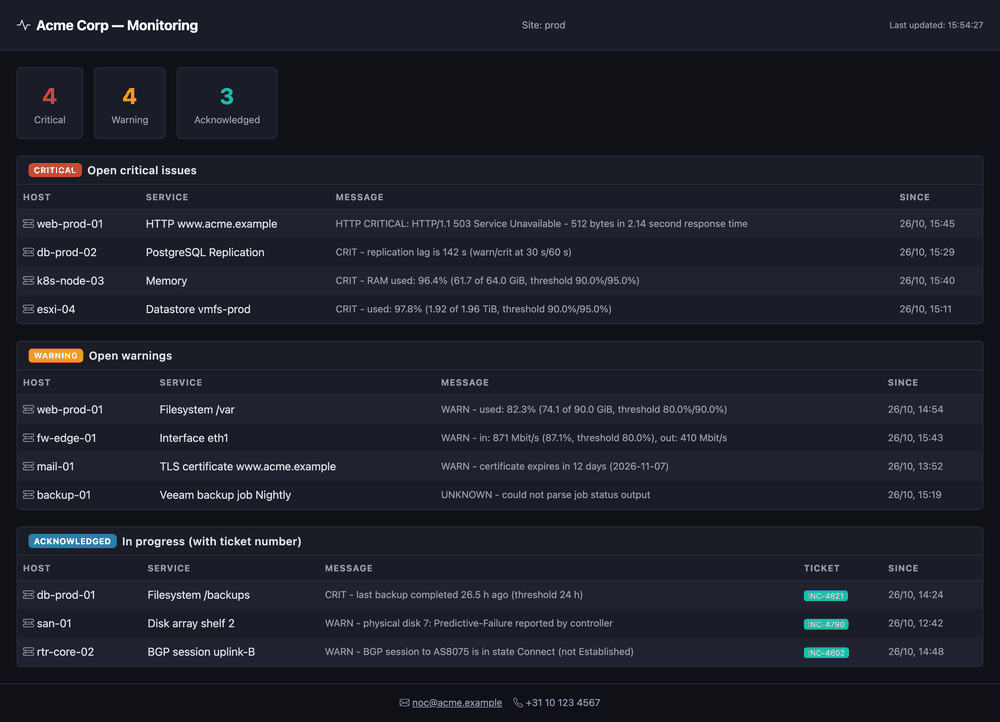
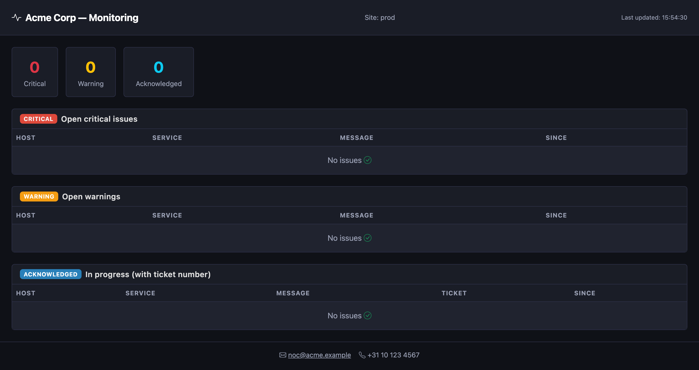
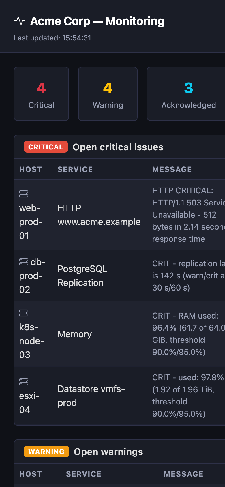

<div align="center">

# Checkmk Client Dashboard

**The screen you can point a client at — without handing them a Checkmk login.**

A tiny, self-hosted, read-only window onto an existing Checkmk instance that shows only the
services that need attention — on one clean, brandable, auto-refreshing page.


[](LICENSE)
[](https://github.com/Timdebruijn/checkmk-dashboard/commits/main)
[](docs/deployment.md)
[](https://www.python.org/)
[](docs/deployment.md)

</div>

---

Checkmk already knows what's broken. The problem is *showing* it to someone who shouldn't be
rummaging around in the Checkmk UI — a client, a stakeholder, the person watching the NOC wall at
2am. This is the thin read-only layer in between: **one GET to Checkmk, one dark page out.**

It shows only non-OK services, in three buckets — **Critical**, **Warning**, and
**Acknowledged (someone's on it)** — and nothing else. The Checkmk UI stays hidden, your
automation credentials never leave the server, and it works on any Checkmk from the free **Raw**
edition up, with no public share link to expire or leak.



## Who it's for

- **Self-hosters** who want a clean status screen without standing up Grafana.
- **Internal NOC / IT teams** who want a red/amber/green wallboard that shows problems, not a full console.
- **MSPs** who want a branded, client-facing status view that never exposes the monitoring tool itself.

## Why you'd want this

**🔒 Client-safe by construction.** The app makes exactly one kind of request to Checkmk: a
read-only `GET` for non-OK services. No viewer input is ever forwarded, credentials live
server-side, and the Checkmk API docs/OpenAPI surface is switched off. You don't harden it after
the fact — there's nothing to hand to the browser in the first place.

**⭐ "Someone's on it" — acknowledged alerts carry their ticket.** Acknowledge an alert in Checkmk
and drop a ticket reference in the comment — a plain `INC-1234` or a full Jira/helpdesk URL,
configurable prefix, case-insensitive — and the dashboard pulls that ticket out and shows it.
Red means nobody's looking yet; the Acknowledged column means it's handled and here's the ticket.
Checkmk has no native per-alert ticket tracking — this is the gap it fills.

Everything else, briefly:

| | |
|---|---|
| **Problems only** | Three fixed buckets, no dashboards to build, no settings to get lost in. **Empty means healthy.** |
| **Brandable** | Your logo, title, an optional support-contact footer, and optional HTTP basic auth — a client-portal look. |
| **Tiny & air-gapped-friendly** | One FastAPI app, native (systemd + nginx) or container (Podman/Docker). No CDN calls, no outbound dependencies; offline installs are first-class. |
| **Runs on Checkmk Raw** | A pure presentation layer over the REST API — no commercial edition or license tier required. |
| **Distributed-monitoring aware** | Filter to a single site, or show them all. |

How alerts are sorted:

| Bucket | Condition |
|---|---|
| **Critical** | state = CRIT (2), not acknowledged with a ticket |
| **Warning** | state = WARN (1) or UNKNOWN (3), not acknowledged with a ticket |
| **Acknowledged** | acknowledged in Checkmk **and** the comment carries a ticket match |

## Screenshots

| All clear | Mobile |
|---|---|
|  |  |

## Quick start

You'll need a reachable Checkmk instance and a read-only **automation user** (Setup → Users) for
the bearer token.

```bash
git clone https://github.com/Timdebruijn/checkmk-dashboard.git
cd checkmk-dashboard
cp .env.example .env     # fill in CMK_URL, CMK_USER, CMK_SECRET
```

Minimal `.env`:

```ini
CMK_URL=https://checkmk.example.com/mysite
CMK_USER=automation
CMK_SECRET=your-automation-secret
```

Run it with Docker:

```bash
docker build -t checkmk-dashboard .
docker run --rm -p 9000:9000 --env-file .env checkmk-dashboard
# → http://localhost:9000
```

…or straight from Python (3.12+):

```bash
python3 -m venv venv
venv/bin/pip install -r requirements.txt
venv/bin/uvicorn main:app --host 127.0.0.1 --port 9000
# → http://localhost:9000
```

That's the whole dashboard. Point it at your Checkmk and you're done.

**Going further:**
- **[docs/deployment.md](docs/deployment.md)** — native (systemd + nginx), container, and offline / air-gapped installs
- **[docs/configuration.md](docs/configuration.md)** — every env var, the logo, ticket filtering, site filtering, and the security notes

## What it is, and what it isn't

Being straight about this matters more than a longer feature list, so:

**It is** a thin, read-only, client-facing view layer on top of Checkmk. It mirrors what Checkmk
already knows about non-OK services and presents it safely and simply.

**It isn't:**

- **Multi-tenant.** There's no per-client data isolation. Basic auth is all-or-nothing per site:
  anyone who can open the page sees every problem on that site. Real per-customer scoping needs
  Checkmk's own contact-group RBAC or a paid MSP edition.
- **Observability.** No metrics, logs, traces, historical graphs, independent checks, or
  notifications. It shows Checkmk's current problem state, nothing more.
- **Real-time.** The front-end auto-refreshes every ~30 seconds. Close enough for a wallboard,
  not a live tick.
- **Independent of Checkmk.** If Checkmk is unreachable, the dashboard says so — it has no data
  of its own. And the ticket signal only works if your team puts the reference in the
  acknowledgement comment.

If you need per-tenant isolation, metrics and history, or independent checks and alerting, use
native Checkmk RBAC / the MSP edition, Grafana, or Uptime Kuma respectively. **This tool
deliberately does one small thing.**

> **TLS note:** certificate verification to Checkmk is **off by default**, since these setups
> usually target internal instances with self-signed certs. Turn it on with `CMK_TLS_VERIFY=true`
> or point `CMK_CA_BUNDLE` at your CA bundle. All Checkmk data is HTML-escaped before rendering.

## How it works

```
Browser ──GET──▶ Checkmk Client Dashboard ──read-only GET──▶ Checkmk REST API
                      (FastAPI proxy)              (automation user, bearer token)
```

Three endpoints, and that's the lot: `GET /` serves the single-page dashboard, `GET /api/config`
hands the page its title and site name, and `GET /api/problems` makes the one call to Checkmk,
sorts the result into Critical / Warning / Acknowledged, and returns it. The browser never talks
to Checkmk directly and never sees a credential.

## Requirements

- An existing Checkmk instance (Raw or any edition) with a read-only automation user
- Python 3.12+ (tested on 3.14), or Podman / Docker

## Contributing

Issues and PRs welcome at [Timdebruijn/checkmk-dashboard](https://github.com/Timdebruijn/checkmk-dashboard).
It's a small codebase on purpose — keep changes small and boring and they'll land fast.

## License

MIT © 2026 Timdebruijn. See [LICENSE](LICENSE).
